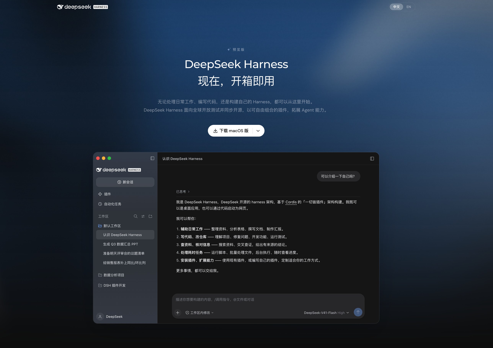
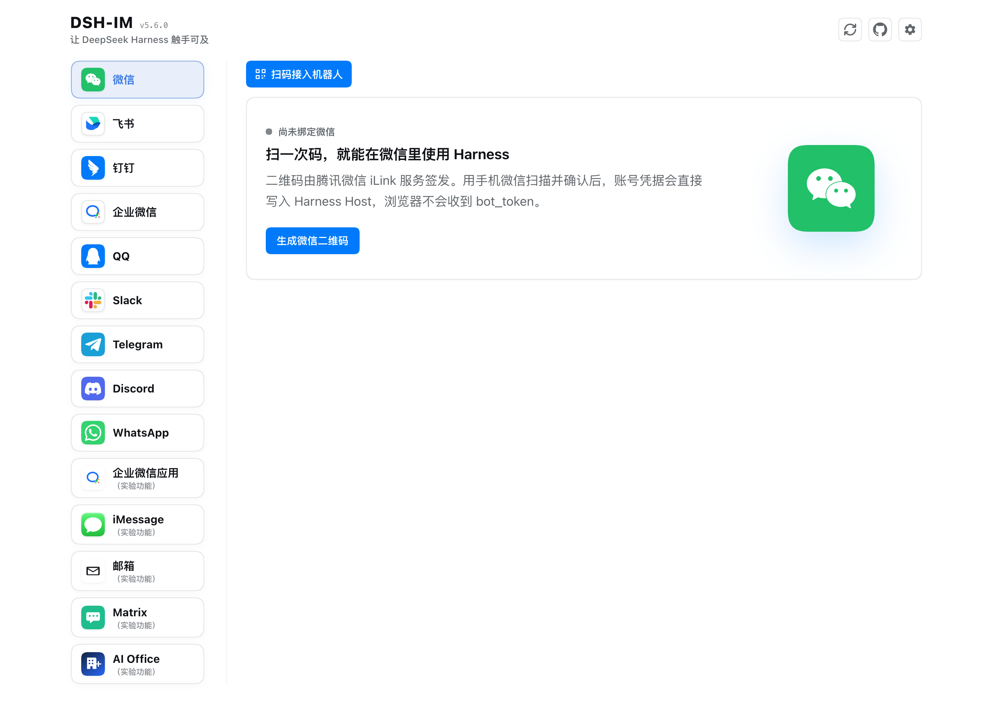

8 月 13 号，DeepSeek 开源了一个叫 DeepSeek Harness 的东西，命令行里叫 `dsh`。两周左右，GitHub 上的 star 就涨到了十几二十万（各家统计日期不同，数字对不上，反正是很多）。

我看到消息的第一反应是：DeepSeek 又出新模型了？

不是模型。DeepSeek 自己的说法很简单：

> Agent = Model + Harness

模型负责想，Harness 负责干活：读你的文件、跑命令、改代码、把结果喂回给模型，再来一轮。你每天用的 Claude Code，也是一个 Harness，里面跑的是 Claude 模型。

所以这篇想把三件事说清楚：它是什么，怎么装起来跑一个任务，以及已经在用 Claude Code 的人有没有必要换。

## 先弄懂 Harness 这个词

Harness 原意是马具，套在马身上，让马的力气能拉动车。放到 AI 编程里，模型是马，Harness 是那套缰绳和车架。

没有 Harness，模型只能在聊天框里给你一段代码，你自己复制粘贴、自己运行、报错了再贴回去。有了 Harness，这一来一回由程序替你做：

- 模型说"我要看一下 `ports.py`"，Harness 去读文件
- 模型说"跑一下测试"，Harness 在终端里执行
- 模型说"把第 8 行改成这样"，Harness 去改

Claude Code、Codex、Cursor 的 Agent 模式，干的都是这件事。区别在于这层"车架"是谁做的、能不能拆。

## dsh 和 Claude Code 差在哪

一句话：Claude Code 是整车出厂，dsh 是一堆零件加一个底盘。

DataCamp 的介绍里有句话说得很准：Claude Code 的主循环是固定的，dsh 允许你通过配置替换循环本身、模型适配器和存储层。

dsh 的设计口号是"一切皆插件"。接哪个模型、有哪些工具、会话怎么存、沙箱怎么做、Agent 一轮轮怎么跑，全是插件，可以换。

落到使用上，最直接的两点：

- **模型随便接**。内置了 DeepSeek、Anthropic、OpenAI、Bedrock、Vertex、Azure，也能加自定义的 OpenAI 兼容地址，比如你本机或内网跑的 Ollama。
- 软件本身 MIT 协议、免费，花钱的只是你接的模型 API。

我平时写代码用的是 Claude Code。效果好是好，但是成天担心受怕的，怕被封号。而且用起来有门槛，账号、网络、付费，哪一样都得折腾。

怕封号也不是瞎担心。今年 7 月，国内开发者的 Claude Code 账号被成片封掉，CSDN 上有文章说，有上百人的公司整个被"团灭"。社区里有人逆向分析，说 Claude Code 识别出中国用户后，会在提示词里动手脚，这个说法我没法核实。Anthropic 那边的解释是反滥用实验，针对账号倒卖和模型蒸馏，后来宣布回滚。同一时间，路透社报道阿里从 7 月 10 日起，禁止员工在工作中使用 Claude Code。再往前，4 月份 Anthropic 已经开始要求部分账号提交护照、驾照做身份核验。

号不在自己手里，用着就不踏实。

dsh 这两个问题都没有：DeepSeek 的 Key 国内直接充值就能用，桌面版装上就能跑。

## 跑起来：从零到第一个任务

最省事的办法是去官网下载桌面版。现在官网首页写的是"现在，开箱即用"，有 macOS 安装包，下载打开就能用，不用碰命令行。



截图里它介绍自己时，列的第一条是"辅助日常工作"：整理资料、分析表格、写文档、做汇报，第二条才是写代码。左边的示例会话也是"生成 Q3 数据汇总 PPT"、"给销售报表补上同比/环比列"这类活。DeepSeek 显然想让不写代码的人也来用。

想装在服务器上，或者想看看它到底怎么跑的，就走命令行。下面的命令来自官方仓库文档和 ComputingForGeeks 的实测，那时候的版本是 `0.1.0-rc.7`，我本机现在已经是 `0.2.1-rc.3` 了。这东西还在快速迭代，命令有出入以官方 README 为准。

**第一步，装 Node。** 要求是 Node 22.19 以上，或者 24 以上。

这里有个坑：Ubuntu 24.04 自带的 Node 是 18，`npm install` 的时候不会提示版本不够，等你启动才报一个看不懂的错：

```
SyntaxError: The requested module 'node:util' does not provide an export named 'parseEnv'
```

看到这句，先别查别的，升级 Node。

**第二步，启动。** 不想全局安装，一条命令就行：

```
npx @deepseek-ai/dsh web
```

第一次跑会安静一两分钟，没有任何输出，别以为卡死了。想装到全局也可以：

```
npm install -g @deepseek-ai/dsh
dsh web
```

启动后浏览器打开 `http://127.0.0.1:3080`。注意，直接敲 `dsh` 不带参数会报错，要用 `dsh web`，或者后面说的无界面模式。

**第三步，填 Key、选目录。** 在 Settings → Models 里找到 DeepSeek，粘贴从 platform.deepseek.com 拿到的 API Key。然后选一个工作目录，没选目录之前，输入框是锁着的，很多人第一次卡在这里。

**第四步，给它派活。** 在输入框里用大白话说你要干什么就行。

不想开网页的，可以直接在终端里跑：

```
DEEPSEEK_API_KEY=你的key dsh --profile headless "总结一下这个仓库是干什么的"
```

## 模式和权限，选默认就行

dsh 内置了四套预设：Standard、PTC、Minimal、Creator。后三个分别给想省调用次数的、做模型评测的、写插件的人用，刚上手就用默认的 Standard。

权限也有三档：只读、可写工作目录（默认）、完全放开。默认那档够用，完全放开的那档，没想清楚别开。

## 我装了哪些插件

"一切皆插件"听着抽象，看看我自己装了什么就具体了。我 10 月装的桌面版，现在是 `0.2.1-rc.3`，除了官方自带的，另外装了 11 个社区插件：

| 插件 | 干什么用 |
|---|---|
| `dshmarket` | 插件市场，逛一逛、点一下就装好，下面这些基本都是从这里装的 |
| `dsh-deepseek-usage` | 侧边栏显示账户余额和当前模型单价，还会提示现在是不是高峰时段 |
| `dsh-context` | 看上下文都被什么占满了，每天花了多少 token、多少钱 |
| `dsh-better-sidebar` | 右侧栏加文件树、能编辑的代码编辑器、改动列表，官方的预览是只读的 |
| `dsh-client-ui-git-graph` | 新会话里选分支，看 Git 提交图 |
| `dsh-ssh` | 连远程服务器，读 `~/.ssh/config`，能开终端、传文件 |
| `dsh-builtin-browser` | 给 Agent 一个真浏览器，它点哪里你都看得见，随时能接手 |
| `dsh-genui` | 回答里直接出可交互的表格、图表、表单，不只是文字 |
| `dsh-im` | 把微信、飞书、钉钉、企微、QQ 这些接进来，在手机上给它派活 |
| `dsh-session-clean-delete` | 彻底删除会话，官方只有归档 |
| `dsh-unlag` | 桌面版用久了卡，点一下就恢复，不用重启 |

我用得最多的是 `dsh-im`，图的就是远程方便。人不在电脑前，掏出手机在微信里给它发一句话，公司那台电脑上的 dsh 就开始干活。



接微信只要扫一次码。二维码是腾讯微信 iLink 服务签发的，扫完确认后，凭据直接写进本机的 Harness，不经过浏览器。除了微信，飞书、钉钉、企微、QQ、Telegram 这些也都能接。

我的用法很简单：临时有事不在工位，直接在微信里给它发消息，让公司的电脑干活。

几个实用的细节，都是插件说明里写着的：

- 它要执行危险操作、需要你点头时，会把审批推到微信上，回一句"批准"或者"拒绝"就行
- 干完活生成的文件，可以直接作为微信附件发回给你
- 发 `/new` 开一个新会话，发 `/stop` 让它停下
- 任务跑太久、微信那头等超时了也不要紧，它干完会把结果补发过来

网上分享的用法大多是这几类，拿来照着用就行：

- 下班路上想起一个 bug 没修，发一句"把 xx 接口的空指针修一下，跑一遍测试"，到家看结果
- 开会时有人问某个功能怎么实现的，让它在仓库里查完把结论发过来
- 让它跑一个耗时的脚本或构建，跑完把日志和产物用微信发回来

> [!WARN]
> 用微信遥控公司电脑，等于给自己的手机开了一个能在公司电脑上执行命令的口子。权限别开到最大，手机也要保管好。

另外两个我会推荐的：`dshmarket` 省得你去 npm 上一个个搜，`dsh-deepseek-usage` 让你随时知道钱花到哪了。

这张表也能看出它和 Claude Code 最大的不同。Claude Code 缺什么功能，你只能等 Anthropic 做。dsh 缺什么，社区两个月就有人做出来了：微信接入、远程 SSH、Git 图，这些都是社区的人做的。

## 几个要知道的坑

它现在还是开发者预览版。官方明说了以后会有不兼容的改动，已经发生过一次：原来叫 Code 的模式改名成了 PTC，会话相关的接口跟着变了，一个可选的 SQLite 存储也删掉了。

> [!WARN]
> 沙箱只管文件系统，不管网络。Wavect 的企业评测专门提了这一点：它能拦住 Agent 乱改你目录外的文件，拦不住它往外发请求。官方的安全说明里也写了，项目还没做过安全审计。

还有两个小坑：

- 如果你之前在 `.env` 里配过 Key，后来又在网页设置里填了一个，`.env` 那个会被悄悄忽略
- Minimal 模式下那个改文件的工具，能改到进程能看到的任意路径，不受沙箱限制

所以别让它碰生产环境和密钥。拿公司电脑用，权限至少收到「可写工作目录」那档。Wavect 的结论我觉得挺中肯：适合拿来做一个隔离的小试点，别因为 star 多就当成正式工具铺开。

## 那到底要不要装

写给两种人：

如果你还没用过任何 AI 编程 Agent，dsh 是个不错的入门方式。免费，接 DeepSeek 的 API 便宜，Mac 上下个桌面版就能用。拿一个自己的小项目让它改几个 bug，你就明白 Agent 和聊天框的差别在哪了。

如果你已经在用 Claude Code，我的做法是两个都留着。正经写代码，我还是用 Claude Code，效果确实更好。dsh 装着当备胎：哪天号真被封了，手上不至于什么都没有。临时有事不在工位，就用微信遥控它。

---

资料来源：DataCamp《What is DeepSeek Harness》、ComputingForGeeks 上手教程、Kanaries 使用教程、Wavect 企业评测、dsh-im 插件说明；封号相关见 CSDN、虎嗅、ChinAI、人人都是产品经理的报道。文中命令和版本以 2026 年 8 月的文章为准，发文前请核对官方仓库 github.com/deepseek-ai/deepseek-harness。
