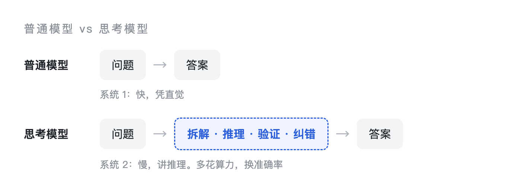
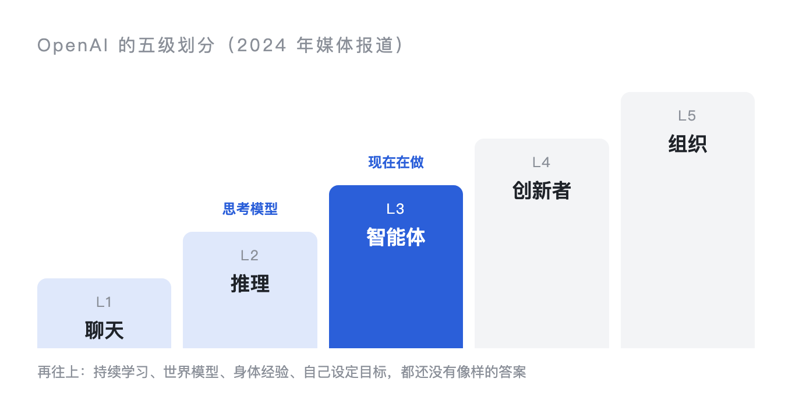
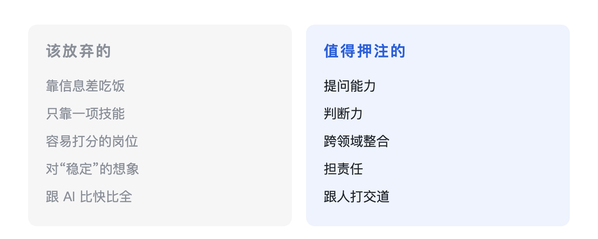

前段时间我跟 AI 聊了一晚上，从“你到底懂不懂”一路聊到“普通人以后该干嘛”。这篇是把那次聊天整理出来，加上我自己的看法。

起因是一件小事。测试同事发给我一张 AI 的截图，说我代码里有个判断取错了数据，会误报，根因、修改思路都写好了，语气很确定。可到现在也没人复现过，它说得对不对，还不知道。

巧的是，被它挑毛病的那段代码，本身也是 AI 写的。这事我前两天单独写过一篇。

> [!TIP] 写代码的是 AI，挑毛病的也是 AI，两边都很有把握。它们到底懂不懂？

## 它在猜下一个字

今天的大模型，不管叫什么名字，干的都是同一件事：从海量文本里学到一个概率分布，然后一个字一个字地预测“接下来最可能是什么”。数据和参数堆得足够大，这种预测看起来就像“懂了”。

聊天里打了个比方：一个背过所有剧本的演员。从《哈姆雷特》到《让子弹飞》，给他任何开头，他都能接一段像样的台词。可他没上过台，没摸过道具，没跟对手对过眼神。他懂的是“剧本里下一句该说什么”。

这就带出几个绕不开的毛病：

- 幻觉：它不知道自己不知道什么，不确定的地方会编；
- 只有相关、没有因果：它学到的是“A 后面常跟着 B”，学不到“A 导致 B”；
- 训练完就冻结：新知识只能靠外挂检索或重新训练；
- 没有世界模型：对物理世界的了解全部来自文字，没摸过，也没摔过；
- 冷门领域覆盖差：越专业、越小众、越新的东西越容易出错。
## 思考模型：多想一会儿再答

2024 年下半年起，OpenAI 的 `o1`、DeepSeek 的 `R1` 这类“思考模型”陆续出来，现在主流产品基本都带了思考模式。

思路很朴素：先把思考过程写出来，再给答案。推理时多花算力，换更高的准确率。训练主要靠强化学习，答对奖励、答错惩罚，慢慢学会先拆解、先验证、再下结论。

用卡尼曼的说法，原来的模型像系统 1，快，凭直觉；思考模型在上面加了个系统 2，慢，讲推理。数学、编程、多步逻辑这类题，想没想过差别很大，所以提升明显。

> [!WARN] 但它没跳出“预测下一个字”这个框，只是把思考过程也变成了预测的对象。==事实性问题照样会编，而且编得更有条理，更难看出来==；简单问题也会想一大堆，有时反而想错；写出来的思考过程也不一定是它真正的推理路径，答案对、过程错的情况也有。

## AGI 没有统一的定义

AGI 是通用人工智能，相对的是今天所有的“窄 AI”：下棋的只会下棋，推荐的只会推荐，换个领域就不行。AGI 指的是能像人一样跨领域学习、迁移、解决问题的系统。

容易被忽略的一点是：**AGI 没有公认的定义**。有人看能力，多数认知任务达到普通人水平就算；有人看自主性，要能自己定义问题、自己学新领域；OpenAI 的说法偏经济，能完成大多数有经济价值的工作。各家按自己的口径说“快到了”或者“还早”，所以那些时间表很难放在一起比。

观点大致分三派。乐观派觉得再迭代几代就到；渐进派觉得一直在往前走，但还要 5 到 15 年；怀疑派以 Yann LeCun、Gary Marcus 为代表，认为靠堆数据、堆参数、预测下一个字，这条路走不到 AGI，理由就是前面说的那几个毛病。

2024 年有媒体报道过 OpenAI 内部的五级划分：聊天、推理、智能体、创新者、组织。思考模型对应第二级，现在大家在做的是第三级。再往上，持续学习、世界模型、真实的身体经验、自己设定目标，这些都还没有像样的答案。

## 接下来几年

预测未来不靠谱，我只说几个已经能看到苗头的方向。

眼下变化最明显的，是 AI 从“会聊天”变成“会干活”。你给一个目标，它自己拆任务、调工具、写代码、跑测试、交结果，人跟 AI 的关系从对话变成委托。

我自己写代码用的是 `Claude Code`，读代码、改代码、跑测试，很多时候交代一句，它自己就去做了。代码确实写得快了，可变化不全是好的：活干得快了，大家的预期也跟着变了，觉得 AI 改一下就几分钟，需求变更反而多了。改一条规则，要重新理解上下文、重新部署、重新测试、重新验收，==这些环节一个都没少==。

再往后是世界模型和具身智能。AI 要真正弄明白“球为什么掉、掉多快、撞到什么会怎样”，要进机器人、进工厂和家庭。没有身体，它就一直是那个没上过台的演员。另一个方向是 AI 做科研：AlphaFold 已经把蛋白质结构预测做到了科学家可以直接拿来用的程度，下一步是让 AI 自己提假设、设计实验。

更远就分岔了。一种是能力一路累积，拼出一种“够用”的通用智能，劳动、教育、收入分配都得重新想；另一种是这条路撞墙，数据用完、堆算力的收益越来越小、世界模型迟迟解决不了，AI 停在“很强但不够通用”的位置很多年。聊天里 AI 的判断是：先涨一段，再在世界模型这一关卡很久。这个判断我说不准，先记在这儿，过几年回头看。

聊天里还提到几个判断：参数竞赛会让位给效率和专用；芯片、能源、数据中心会变成国家之间争夺的资源；决定结局的可能是教育、法律、就业市场跟不跟得上，模型本身反而在其次。

## 普通人该放弃什么、押注什么

聊到最后，真正和我有关的就这一个问题。

先说该放弃的：

- 靠信息差吃饭。查资料、整理资料的成本快降到零了，如果你的价值是“我知道你不知道”，要早做打算。我见过不少需求文档，就是把运营的话整理一遍发给开发，这种传话的活，AI 已经能做了。
- 只靠一项技能。只会写代码、只会做账、只会画图，执行层最容易被换掉。专精没问题，但得再叠一层：懂业务、懂人，或者能扛责任。
- 容易打分的岗位。这条有点反直觉：越容易 KPI 化的工作越容易被替代，因为**能打分，就有了训练 AI 的标准答案**。
- 对“稳定”的想象。聊天里有个说法：风险最大的未必是基层，反而是大公司里的中层：流程清晰、产出可量化、不扛最终责任、薪水不低，替换起来最划算。
- 跟 AI 比快比全。记得多、读得快、搜得全，这条路必输。

再说值得押注的：

- 提问能力。问题定义清楚了，AI 能把方案做出来；问题问得烂，只会得到一堆正确的废话。
- 判断力。AI 能给一百个方案，选哪个、为什么选、敢不敢拍板，是人的事。判断力来自踩过的坑和对真实世界的体感。
- 跨领域整合。真实的问题从来不按学科分好类。
- 担责任。AI 不能签合同，也不能为后果负责。签字、担保、拍板、带团队，这些环节会留在人手里，==能扛事的人会更值钱==。
- 跟人打交道。共情、谈判、说服、陪伴，很多时候人要的就是另一个人。

---

聊天里有一句话：

> [!GOLD] 一个会用人、也会用 AI 的人，带着一群 AI，去服务那些不想碰 AI 的人。

哪怕公司只有你一个人，也可以是你加一堆 AI。
