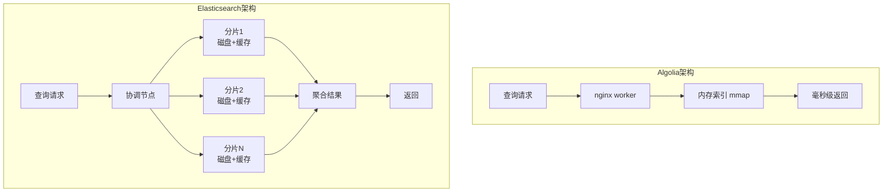

# 搜索双雄对决：Algolia 和 Elasticsearch 到底怎么选？

你在做一个电商网站，老板说：“我们的搜索要像淘宝一样，输一个字就出结果，还不能卡。”你心里咯噔一下：自建 Elasticsearch 集群？调分词、优化内存、搞定实时索引……没个把月搞不定。这时，同事推荐了 Algolia——号称“搜索即服务”界的闪电侠。

但另一边，ES（Elasticsearch）是开源界的老大哥，功能强大到能搜日志、能做分析。到底选谁？今天我们就来扒一扒这两位搜索双雄的底裤，看明白它们根本不是一种生物。

## 一、根本定位：拎包入住的公寓 vs 自己盖的别墅

理解 Algolia 和 ES 的区别，首先要从它们的“出厂设置”说起。

### Algolia：搜索即服务

**Algolia 是一家托管式搜索 API 服务商**。你不需要管服务器、装软件、调集群，只需要把数据通过 API 推到 Algolia 的云端索引里，前端调一个搜索接口，就能拿到毫秒级的结果。

这就像租了一套**全屋智能的精装公寓**：物业（Algolia）把一切都打理好了，你只需拎包入住。想要换灯泡（配置同义词）、调窗帘（自定义排序），物业也给你提供了简单的开关面板，但如果你想砸墙改造，那是不允许的。

它的核心承诺是：**快（毫秒级）、准（开箱即用的相关性）、省心（零运维）**。

### Elasticsearch：开源搜索和分析引擎

**Elasticsearch 是一个基于 Apache Lucene 的开源分布式搜索引擎**。你需要自己下载、部署、调优，把它安装在你自己的服务器或云主机上。

这就像买了一块地，给你图纸和建材（开源），你自己打地基、通水电、盖房子。你可以盖成别墅，也可以盖成写字楼（通过分片、副本扩展），想怎么装修就怎么装修，但一切得自己动手。

它的核心优势是：**强大（功能全面）、灵活（深度定制）、免费（开源）**。

## 二、核心原理：内存闪电侠 vs 磁盘大力士

它们为什么一个那么快，一个那么强？秘密藏在架构里。

### Algolia：全内存索引 + 极简进程

Algolia 把**索引文件全部存储在内存（RAM）中**，并通过内存映射直接挂载到 nginx worker 进程的地址空间。查询时，无需跨进程通信，也无需从磁盘读取数据，直接在内存里计算，这使其单次查询延迟能稳定在 1-20 毫秒【turn0search4】。

它每台机器只跑三个进程：
1.  **nginx**：内嵌查询引擎，直接在 worker 进程内执行 mmap 索引查询。
2.  **Redis**：负责限流、配额检查、实时日志。
3.  **Builder**：处理所有写操作，执行 Raft 共识、构建索引段。

这种“极简主义”设计让运维复杂度大幅降低，也支撑起 99.99% 的 SLA。

### Elasticsearch：基于 Lucene 的分布式巨兽

ES 的索引存储在**磁盘**上，通过操作系统的文件系统缓存来加速访问。如果数据量远超内存，查询时就需要从磁盘读取，延迟会显著增加（尽管有各种缓存优化）。

它的架构是**分布式分片**的：
*   数据被分成多个分片，分布在多个节点上。
*   写入时先写入内存缓冲区，定期刷新到磁盘。
*   查询时可能需要跨多个分片和节点聚合结果。

这种设计让它能处理 PB 级别的海量数据，并且具备强大的横向扩展能力，但代价是查询延迟通常在几十到几百毫秒级别（针对大索引），且需要精心调优才能保证性能稳定。

## 三、能力与场景：精准狙击手 vs 全能重机枪

它们各自擅长什么？一张表看懂核心差异。

| 维度 | Algolia | Elasticsearch |
| :--- | :--- | :--- |
| **部署形态** | 纯 SaaS，零运维 | 自部署或云托管，需运维 |
| **响应延迟** | **极低**（1-20ms），首字节即出结果 | 较快但通常几十到几百ms（大索引） |
| **设置成本** | **低**，注册账号即用，几小时上线 | **高**，需集群规划、调分词、调相关性 |
| **数据规模** | 适合 GB-TB 级，**内存受限** | 可处理 **PB 级**，横向扩展能力强 |
| **定制能力** | 中等，配置项丰富但封闭 | **极强**，可写自定义评分、聚合、脚本 |
| **日志/分析** | 不擅长 | **强项**，ELK Stack 核心组件 |
| **前端体验** | **极佳**，InstantSearch 组件库开箱即用 | 需自己构建前端交互逻辑 |
| **成本模型** | 按搜索次数+记录数计费，**量大会变贵** | 开源免费，但**运维和硬件成本高** |
| **典型场景** | **电商、文档、SaaS应用内搜索** | **日志分析、复杂聚合、企业级数据检索** |

### Algolia 的超能力

1.  **即时搜索**：用户每敲一个字符，Algolia 就完成一次全量检索并返回结果，体验极其流畅。
2.  **开箱即用的相关性**：内置 8 级 tie-breaking 排序公式（错别字、词邻近度、属性重要性等），无需复杂调优即可得到高质量结果。
3.  **前端友好**：提供 React InstantSearch、Vue InstantSearch 等组件库，前端工程师能快速搭出漂亮的搜索界面。
4.  **AI 搜索**：NeuralSearch 用神经哈希技术把向量检索压缩到和关键词检索一样快，让语义搜索变得经济可行。

### Elasticsearch 的超能力

1.  **无上限的扩展性**：通过增加节点轻松处理 PB 级数据，是大数据场景的首选。
2.  **强大的分析能力**：不仅仅是搜索，更是强大的数据分析引擎，配合 Kibana 可做日志分析、安全分析、业务监控。
3.  **深度定制**：从分词器到打分公式，一切皆可自定义，能满足各种复杂搜索需求。
4.  **数据安全与主权**：可完全自建在内网，满足金融、政务等行业的严格合规要求。

## 四、成本与运维：按需付费 vs 自给自足

### Algolia：SaaS 模式，为省心付费

*   **免费版**：每月 10,000 次搜索 + 100 万条记录，对个人博客和小型文档站够用。
*   **付费版**：按搜索次数和记录数阶梯计费。流量小时成本可控，但流量大时账单可能指数级增长（有用户反馈年费轻松到几万美元）。
*   **运维**：零运维。你不用管服务器宕机、备份、升级、安全补丁，Algolia 全包了。

### Elasticsearch：自建模式，人力硬件是大头

*   **软件成本**：开源免费。
*   **硬件成本**：需要采购或租用服务器、网络设备、机柜，以及电费、带宽费。
*   **人力成本**：这是最容易被忽略的。一个中级 DBA/运维工程师年薪加社保约 20-40 万，还需要投入培训、值班成本。
*   **长期TCO**：对于使用三年以上、业务量大的情况，自建的综合成本可能低于 SaaS，但初期投入和风险更高。

## 五、决策指南：到底选哪个？

没有绝对的好坏，只有合不合适。根据你的场景对号入座：

### 选 Algolia 如果你：

✅ **追求极致用户体验**：做电商、SaaS 应用，希望搜索框“输入即出结果”，体验像大厂一样丝滑。
✅ **团队缺搜索专家**：没有专职的 DBA 或搜索工程师，不想把精力耗在集群运维上。
✅ **数据量可控**：你的数据是商品、文档、用户信息等结构化数据，规模在 GB 到 TB 级，不是 PB 级日志。
✅ **想快速上线**：希望几天内就把搜索功能跑起来，而不是花几个月搭建基础设施。
✅ **预算按需付费**：愿意为省心和服务付费，且流量不算巨大。

### 选 Elasticsearch 如果你：

✅ **处理海量数据**：需要搜索或分析 PB 级的数据，尤其是日志、监控、安全事件等。
✅ **有严格合规要求**：数据不能出境，必须物理隔离在自有内网，是金融、政务、军工等场景。
✅ **需要深度定制**：搜索逻辑非常复杂，需要自定义打分、复杂的聚合分析、脚本字段等。
✅ **有技术团队**：公司有运维团队，能承担集群管理、性能调优、故障排查的工作。
✅ **预算有限且规模大**：长期看，自建的成本效益更高，尤其当数据量和查询量都很大时。

## 结语：工具选对，比选贵更重要

Algolia 和 Elasticsearch 并非直接竞争，而是互补关系。Algolia 解决了“**做一个让用户爽的搜索框**”这件事的门槛问题，把它降到了几行代码的程度。而 Elasticsearch 则是“**掌控底层、做大规模数据分析**”的基石。

最终的选择，不取决于谁更强，而取决于你的业务需求、团队能力和成本结构。希望这篇文章能帮你做出明智的决策。

> 💡 **你正在用哪个搜索方案？为什么选它？** 欢迎在评论区分享你的选型故事和踩坑经验。