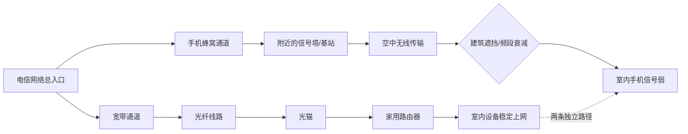

# 办了电信宽带网速飞起，手机却常常"无服务"？这俩根本不是一回事

最近后台有位读者抛了个特别经典的问题：

> "我家办了电信宽带，WiFi嗖嗖的，可手机信号一进卧室就剩一格，打电话还得趴窗户边。同样是电信，差距咋这么大？"

> "再说了，现在不都有铁塔公司了吗？移动、联通、电信共用一个基站，凭什么我电信信号还是不行？"

其实，这两件事的答案都藏在一句话里：**宽带和手机信号，从根上就是两条互不相干的路；铁塔公司共享的也只是"塔"，不是"信号"**。今天就把这事一次讲透。

## 一、宽带快 ≠ 手机信号好，它们压根走的不是一条路

很多人下意识觉得："都是电信的，宽带好用，手机信号总不会差吧？"这个判断本身就立不住。

打个比方：电信宽带像一根**从电信机房直接铺到你家墙里的光纤水管**，只要管子通、水龙头（路由器）没坏，水流就稳；而手机信号像**洒水车在街上喷的水雾**——你在哪条街、离车多远、有没有楼挡着、当天有几辆车同时作业，都会影响你接到的水多水少【turn0search9】【turn0search14】。

一张图看懂两条路径的分叉：

所以"宽带好、手机信号差"这种组合，非但不矛盾，反而再正常不过。

## 二、有了铁塔公司，为什么信号还有差距？

这是大家最想不通的点：**不是都说三家共用一个基站了吗？**

关键在于——**铁塔公司共享的只是"铁塔塔体 + 机房 + 电源空调"这一层物理设施，真正发射信号的主设备（BBU、RRU、天线）和使用的频段，依然由各家运营商自建自维**【turn0search1】【turn0search5】【turn0search16】。铁塔公司成立时，三大运营商高管就明确证实过：只合资建铁塔，基站设备不共享【turn0search20】【turn0search22】。

再打个比方：铁塔公司像个**"包租婆"**，盖了栋写字楼，把楼层租给移动、联通、电信三家。但谁家装修、装什么型号的设备、用哪个频段、调什么角度的天线、回传光纤走不走得通——全是各家自己的事。同一栋楼里三家店铺，装修档次、灯光亮度、空调温度都不一样，体验当然不同。

具体差异来自这几张牌：

| 差异维度 | 各家情况 | 对信号的影响 |
|---------|---------|------------|
| **频段不同** | 移动主要2.6GHz+广电700M；电信联通5G用3.5GHz，电信还有800M低频；频段越低穿透越强【turn0search2】【turn0search12】 | 同功率下700M覆盖范围约为2.6GHz的9倍，3.5GHz室内穿透比1.8GHz还高约14dB |
| **主设备各自建设** | BBU、RRU、天线全是各家独立采购、独立安装、独立优化【turn0search5】【turn0search14】 | 设备型号、功率、方位角、下倾角调校不同，覆盖能力天差地别 |
| **入驻率不同** | 铁塔按租户收费（单租100%、两家80%、三家70%），运营商按预算决定是否入驻【turn0search6】 | 并非每座铁塔都有三家设备，移动财大气粗租得多，电信联通部分站点没入驻 |
| **天线挂高位置不同** | 铁塔多层平台，第一平台挂高最高、覆盖最广，但只能放一家【turn0search7】【turn0search9】 | 抢到第一平台的天线覆盖半径明显大于第二、第三平台 |
| **传输回传不同** | 光纤回传各家独立铺设，有些机房想进但没传输资源【turn0search8】 | 有塔有设备但没传输，基站也开不起来 |
| **核心网与优化不同** | 三家各自独立的核心网、容量调度、参数优化策略【turn0search3】 | 同样有信号，拥塞时网速体验差异巨大 |
| **室分系统各自建设** | 写字楼/小区内部覆盖仍是三家独立建设【turn0search8】 | 办公室只有移动室分，电信联通用户室内照样没信号 |

5G时代倒是有变化，但也是"两两抱团"：**电信+联通共建共享一张5G网（3.5GHz），移动+广电共建700M低频网**【turn0search16】。注意，这是成对合作，移动和电信之间在5G上仍是各自独立的网络，整体差异依旧存在。

一句话总结：**铁塔共享解决的是"重复建塔、选址难"的土地资源问题，解决不了"频段不同、设备不同、投资不同、优化不同"的信号质量问题**。

## 三、那手机信号差，到底怎么办？

按这个优先级走，基本能解决90%的情况：

**第一招：打开VoWiFi，让家里宽带"兼职"当基站**

这是电信这两年主推的方案。原理很直白——既然家里WiFi信号好、宽带稳，那就让通话走WiFi这条路，绕开基站覆盖不到的盲区【turn0search1】【turn0search5】。四川电信2024年试商用的数据显示，近6成用户网络质量得到提升，对业务满意用户达72.5%，覆盖家中全屋或部分房间信号差的场景效果尤其明显【turn0search7】。

操作路径大致是：设置 → SIM卡与移动网络 → 选择电信卡 → 开启"WLAN通话"或"Wi-Fi通话"。目前小米、OPPO、vivo等厂商的12款以上终端已支持，无需换卡、无需换套餐，语音时长直接走原套餐【turn0search7】【turn0search9】。需要提醒一句：VoWiFi的通话质量取决于家里路由器，几十块的廉价路由延迟丢包高，通话容易断续【turn0search5】。

**第二招：先分清是个例还是区域问题**

拿别人的电信手机在同位置测一下，或把自己的卡插到别的手机里。别人也差，就是基站覆盖问题；只有自己差，排查手机和SIM卡【turn0search6】。SIM卡金属触点氧化、卡槽松动这些隐形小毛病，擦一擦、重插一下往往有奇效。

**第三招：联系运营商客服反馈基站问题**

如果整个区域信号长期差，拨打10000号反馈，要求核查附近基站覆盖。电信会根据投诉密度评估是否补建基站或室分系统，长期反馈比闷头忍受管用得多。

**第四招：固定场所长期信号差，可考虑合规信号放大器**

家里或办公室长期信号差且运营商迟迟不解决，可以装合规的手机信号放大器（直放站），但必须符合国家规定，避免干扰公共网络，最好先咨询电信官方再决定【turn0search6】。

**第五招：极端情况——携号转网**

如果所在区域电信基站长期无改善，而移动或联通信号明显更好，携号转网到覆盖更优的运营商是根治办法。毕竟频段和基站布局是死的，换个运营商可能就换了一片天。

---

**最后留个互动话题**：你家是宽带稳如老狗、手机信号却频频"离家出走"吗？试过VoWiFi没有，效果如何？欢迎在评论区聊聊你家的"信号玄学"，说不定下一篇就拆解你的具体场景。

觉得有用，点个**在看**或转发给那个总在窗边找信号的朋友，咱们下篇见。